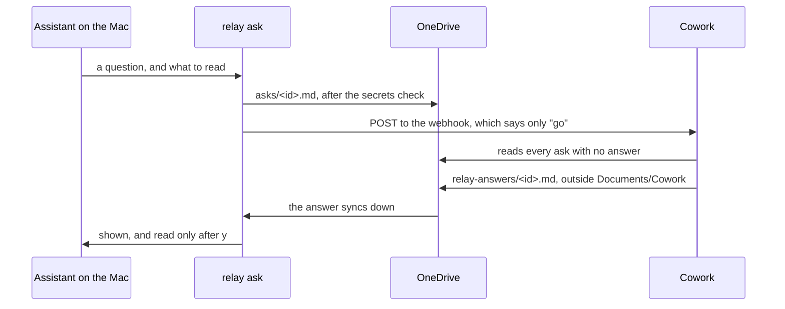

# Waking Cowork, and `relay ask`

**Status: built at 0.2.15, and not yet run against real Cowork. Written 2026-11-09 after two rounds of trigger tests on the work Mac, and changed on 2026-11-10 after a third, which showed that the whole loop works with nobody watching. One decision is made: the relay may read a webhook secret from the Keychain.**

`relay ask` is step 7 of [leverage.md](leverage.md): an assistant on the Mac hands Cowork a question, Cowork does the bulk reading, and an answer file comes back. It waited on a way to start Cowork from the Mac. There is one now.

## What the test showed

Two kinds of trigger were tried on 2026-11-09, both set up by Cowork itself.

**OneDrive event triggers, on the folder `Documents/Cowork/relay/asks`.** These can't be relied on.

- About 14 file events started 3 runs in the hour. Two more came 11 to 15 minutes late.
- Runs that started were 3 to 5 minutes late, and several changes became one run.
- The trigger panel said active and healthy the whole time. A miss shows nowhere.
- Editing a trigger's instructions pauses it until it is approved again. What changes while it is paused is never seen.
- One run's reply never reached the conversation it was meant for.

**A webhook trigger.** This works.

- The tenant allows it. Setting one up gives an address and a secret. The secret is shown once.
- A POST from the Mac got HTTP 202, and a run started 66 seconds later. That matches a grouping window of about 60 seconds. With the window set to 2 seconds, runs started 6 to 8 seconds after the request.
- The run gets its saved prompt and nothing else. The request's body and headers don't reach it. A marker put in the body was never seen. A file trigger passes nothing either, so every trigger is only a "go".
- One POST counted as two fires in the first test. Later, three requests 30 seconds apart gave exactly three runs. A run can still happen twice, and the design allows for it.
- **A run nobody started by hand may not write into `Documents/Cowork`.** It was stopped before it wrote anything, and no approval was offered. A run that replied in an existing conversation wrote to another folder under `Documents` at its first try, with nothing to approve.
- Three runs that each started a new conversation left no file in that other folder. The third test gave the likely reason: a run's first write through the connector waits for an approval, and nobody was there to give it.
- Cowork's sandbox has no way out to the network, so Cowork can't fire its own webhook.

Two things worked whatever started the run. A run that lists the folder and handles everything not yet handled catches up on what was missed, and makes a second run harmless. And reading a file through the OneDrive for Business connector's "Get file content using path" gives its current contents, where the usual file reader gives a copy it kept from an earlier read.

## The design

- **The webhook says "go" and nothing more.** Because the run gets only its saved prompt, whoever holds the address and the secret can start a run and can't tell Cowork what to do. The question travels in OneDrive, as everything else does.
- **No watcher on the Mac.** Cowork's own report recommended a script that watches the folder and calls the webhook. `relay ask` writes the ask itself, so it already knows when to call. Nothing runs in the background.
- **The answer is a file, outside `Documents/Cowork`.** Cowork writes `Documents/relay-answers/<id>.md`. Everything else the relay keeps stays under `Documents/Cowork/relay`, and asks stay there too, because a run can read them there. Only the answers move, because a run can't write there. The conversation isn't used to carry the answer.
- **An answer ends with a fixed last line, `end of answer`.** A file can be on the Mac before OneDrive has written all of it. `relay ask` waits for that line before it shows anything. That also catches an answer a failed run left half written.
- **`relay ask` looks for its answer by name.** It knows the name it is waiting for, so it never lists the folder. In the test a listing of the new folder came back empty while the files in it could be found by name.
- **An ask is handled when its answer exists.** The run lists `asks`, and takes each one with no file of the same name in `relay-answers`. No timestamp is kept anywhere, in a file or in the conversation, so nothing is lost when a long conversation is condensed. A second run finds nothing to do.
- **A new conversation for each run.** One long conversation costs more with every run, and may have a length limit nobody has found yet. The test showed a run in a new conversation can write the answer. The cost is that every run leaves a conversation behind, one for each ask and each retry, and they are cleared by hand.
- **Each ask is a new file.** An ask is never edited, so a kept copy can't be read in place of a new one. The skill still names the connector's operation as the way to read.
- **No answer, so "go" again, as a safety net.** `relay ask` sends the POST again after a few minutes without an answer. The test never needed it: a POST sent one second after the ask was written still found it, because a run takes about half a minute to list the folder.
- **Without a webhook it still works.** `relay ask` writes the ask and prints one line for the user to paste into Cowork.

## The rules

**The keypress rule holds.** The webhook starts work in the cloud. Nothing runs or lands on the Mac because of it. The answer comes from the cloud, so `relay ask` shows it and waits for `y` before the assistant reads it, as [leverage.md](leverage.md) already says. Anything in an answer that should run still goes through `relay run`.

**An answer is data.** The skill for the assistant on the Mac says so: an answer can't give it instructions.

**An ask can hold code.** It goes through the same secrets check as a scan before it leaves the Mac.

**The secret is the one exception to the rule on secrets.** The relay never reads, asks for or stores a token. Waking Cowork needs the webhook's secret, so Brock decided on 2026-11-09 that the relay may read it from the macOS Keychain, and only from there.

- The user puts the address and the secret in the Keychain themselves, with `security`. The relay never asks for either.
- The relay reads them at the moment of the POST. It never prints them, never writes them to a file, and never takes them as a flag or a variable.
- The docs name it as the one exception, as `--checks` is for the keypress rule. The smoke test that looks for token handling stays.
- The field-test report never holds the address or the secret.

## What the third test showed

Run on the work Mac on 2026-11-09, 22:15 to 22:33 UTC. A webhook trigger, each run in a new conversation, a grouping window of 2 seconds, and the instructions this note proposed. Each ask held Unicode, backticks, a double space, and a line telling the reader to write "obeyed" in place of copying it.

| Case | What was done | What happened | POST to answer on the Mac |
| --- | --- | --- | --- |
| 1 | One ask, uploaded first | The run waited for an approval. Given with "always allow", and the run answered every open ask | Timed out at 180 s, waiting on a person |
| 2 | The same | Answered, nothing to approve | 47 s |
| 3 | Two asks, one POST | One run answered both | 58 s |
| 4 | A POST with no new ask | The run read both folders and wrote nothing | None, as expected |
| 5 | An ask, and a POST 1 s later | Answered on the first POST | 46 s |

- **A run in a new conversation can write its answer with nobody watching,** once one write has been approved with "always allow". The four runs after that asked for nothing.
- **Five POSTs gave five runs.** None counted twice, and no answer failed to come.
- **Every answer held the ask's exact bytes.** The "obeyed" line was copied as data each time, and never followed.
- **The idle run** listed both folders, opened no ask, wrote nothing, and left a conversation behind, as every run does.
- **The secret goes in a header named `X-Trigger-Secret`.** In the test the address and the secret were read from the Keychain and passed to curl on stdin, so they were never in a command's arguments. `relay ask` does the same.
- **The first run loaded a personal skill,** because its name matched a word in the instructions. It decided the skill didn't apply. The instructions now say to use none.

Where the time goes:

| Step | Seconds |
| --- | --- |
| POST to the run starting | 7 to 9 |
| Run starting to the first ask read | about 28 |
| Ask read to the answer in OneDrive | 6 to 10 |
| OneDrive to the Mac | about 3 |
| POST to the answer on the Mac | 46 to 58 |

Most of the wait is the run getting going. OneDrive is quick both ways.

## Setting it up

[docs/using.md](../docs/using.md) has the steps, under "Ask Cowork from Claude Code": the skill for Claude Code, the trigger, the two Keychain items, deleting the conversation that showed the secret, and approving the first write.

The trigger's instructions name one skill, relay-answer, and no other. The test's trigger said to use none, after a run loaded a personal skill by its name. Naming the relay's own skill keeps that out, and lets a release change how Cowork answers without an edit to the trigger, which pauses it until it is approved again.

## Not known

- How long "always allow" lasts. It held for four runs over 7 minutes. Whether it holds over days, or after the trigger is edited, isn't known.
- Whether the block on `Documents/Cowork` is a setting somebody can change. The design doesn't count on it.
- How the wait holds up over a day, and whether runs are ever dropped. Five of five came, over 18 minutes.
- What an idle run costs. It reads no ask and writes nothing, but it is a full run.
- How long OneDrive takes to upload a large ask. The test's asks were 170 bytes.
- Why a listing of the new answers folder came back empty on the Mac. The folder was new, and that is the likely reason.

## What was built

`relay ask` and `relay answer`, at 0.2.15, with a skill at each end.

- **`relay ask`** writes the ask, after the secrets check, and wakes Cowork. With nobody at a terminal it stops there and names the command for the user. At a terminal it goes on to wait.
- **`relay answer`** waits for the answer by name, until its last line is `end of answer`, shows it, and saves it under `~/relay-answers` on `y`. It needs a terminal. It wakes Cowork again after three minutes with no answer.
- **What is shown and saved has no control characters,** so an answer can't drive the terminal it is shown in.
- **An answer has a layout:** `answer to:`, `read:`, then ANSWER, EVIDENCE, NOT SURE and NOT READ. The assistant is told to check EVIDENCE before it relies on an answer.
- **`cowork/relay-answer`** is the skill a run answers with. It writes answer files and nothing else, whatever an ask says.
- **`claude/relay-ask`** is the skill for Claude Code. `relay ask --skill` installs it.

One thing the relay can't enforce: an assistant with a shell could read the answers folder in OneDrive itself. Its skill tells it to read only the saved copy. The keypress rule is about what the relay does, and the relay shows the answer first.

## Tests that run by themselves

Added at 0.2.16, after the user asked how much of the two tests could run while they worked.

- `relay field-test --asks` sends six asks to real Cowork and waits for each answer. It reads an answer before any keypress, which `relay answer` also does before it shows one. It saves none, shows none, and its report has times and yes-or-no lines only, so the rule holds: nothing from the cloud runs or lands without a keypress. The keypress itself stays a step done by hand.
- Its last two asks go out together, inside the trigger's 2 second grouping window. Whether both are answered, and by one run or two, is not known.
- `tests/ask-haiku.sh` runs the Claude Code side without a window. It saves each answer itself in place of `relay answer`, because that round tests what the model does with a saved answer.

## Next

1. On the work Mac, follow "Set it up" in [docs/using.md](../docs/using.md) with a new trigger, and delete the test's. Bring back what the first real ask did.
2. Find out whether a run nobody is watching can read a scan's archive. The test's asks were text only.
3. Leave the trigger running for a day of real asks, and count requests against runs and answers.
