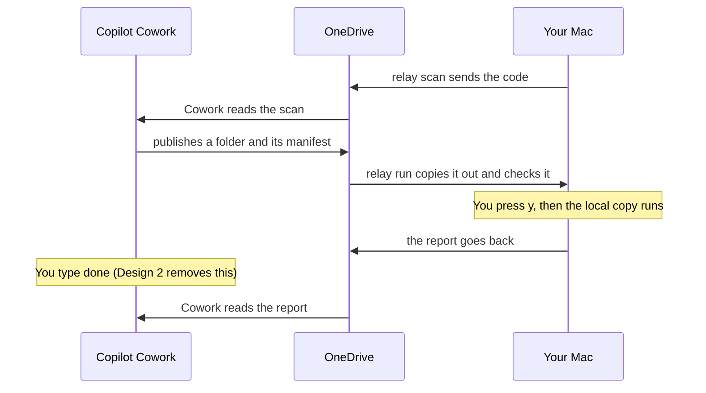

# Proposed design

**Status: Design 1 is built and merged, on 2026-11-05 as [pull request 1](https://github.com/broxgit/llm-relay/pull/1). Design 2 is proposed, not adopted.** Written against commit 6541e46, before Design 1 was built.

This proposes two changes to the relay: make the keypress gate hold against pipes and variables, and wake Cowork after a run without typing "done". [roadmap.md](roadmap.md) has the order and the decisions they need.

- **What changes in the code:** the yes/no prompt reads the terminal itself instead of standard input, and `relay run` can make one optional HTTPS post after a report is sent.
- **What stays:** Bash, OneDrive as the only channel between Cowork and the Mac, the manifest format, and the skill's contract with Cowork.
- **What it rests on:** 412 smoke tests passing under Apple's bash 3.2, with shellcheck clean. Four field tests and one real merge request review ran before the split from llm-wiki. Nothing has run with real Cowork since.

## Goals and hard rules

The goal is fewer manual steps per round without weakening the one rule that makes the relay safe to use: nothing from the cloud runs or lands on the Mac without a keypress there.

Goals:

- Make that rule true of the code, not only of its flags.
- Replace "only run in smoke tests" with "ran for real" for everything built since the last field test.
- Remove the step where the user types "done" to Cowork after each run.

Not goals:

- Running anything on the Mac unattended.
- A port to Go, native Windows, or GitHub pull requests.
- A network path from Cowork into the Mac.

Hard rules the design keeps:

| Rule | Where it comes from |
|---|---|
| `relay run`, `review` and `apply` need a keypress at a terminal, with no way to skip it | Brock's decision, and [AGENTS.md](../AGENTS.md) |
| Works on Apple's bash 3.2, with no loop fed by process substitution | `AGENTS.md`, checked by a smoke test |
| Every change lands with a test, on a branch, with smoke tests and shellcheck green | `AGENTS.md` |
| A passing smoke test is never reported as working with Cowork | `AGENTS.md` |
| The relay may call `wiki which`, and works without a `wiki` command | The split from llm-wiki |
| Anything needing real Cowork comes with exact steps and a list of what to bring back | Cowork is only on the work Mac |

## How the relay works today

Every exchange between Cowork and the Mac is a file in OneDrive, and anything that arrives from Cowork passes one prompt before it runs or is saved. Cowork can't read local files or reach the network, so the Mac sends it code to read, and Cowork publishes folders for the Mac to run.

The keypress is the only point where something from Cowork starts running. Typing "done" is the step Design 2 removes.

| Command | Direction | What it does | Asks first |
|---|---|---|---|
| `relay setup` | Mac to OneDrive | Copies the `remote-pair-run` skill for Cowork, and records where clones and reviews live | No, nothing arrives |
| `relay scan` | Mac to OneDrive | Sends a branch, the uncommitted changes and the repository's wiki pages | No, nothing arrives |
| `relay mr` | Mac to OneDrive | Sends a GitLab merge request, its branches and the user's Go libraries. Can run go build, vet and test on a temporary copy | Asks before the checks, unless `--checks` is passed |
| `relay run` | OneDrive to Mac | Waits until a deliverable matches its manifest, copies it to a local folder, shows it, runs the copy, and sends the report back | Yes |
| `relay review` | OneDrive to Mac | Saves the review Cowork wrote where reviews are kept | Yes |
| `relay apply` | OneDrive to Mac | Applies proven patches to the working tree. Never commits | Yes |

What has run for real, all of it as `wiki relay` before the split:

- Whole rounds on a throwaway repository from Apple's Terminal on 2026-11-04: a fresh publish, a real failure, its fix, and pressing `n`.
- One merge request review on real code on 2026-11-04, before the checks and the Coverage section existed.

What has only run against fakes: the standalone `relay` command and its `relay setup`, the fallback to the old settings file, the checks, the Coverage section, `safe_worktree`, `relay scan --branch`, the wiki copy, `relay apply`, and the message printed when macOS refuses a read.

## Design 1: make the keypress gate hold

Before this was built, a pipe and one environment variable could answer the prompt, so the rule held for flags but not for the code. The fix was to take the answer from the terminal itself. The rest of this section is the design as proposed, with what changed while building noted in place.

What the code did at 6541e46:

- `needs_terminal` passes when standard input is a terminal, or when `RELAY_TEST_TTY` is set.
- `ask_to_run` reads one key from standard input.
- So `printf y | RELAY_TEST_TTY=1 relay run ...` runs a deliverable with no terminal. The smoke suite drives `run`, `review` and `apply` this way.

Cowork can't use this, because it can't set a variable on the Mac. An agent or script on the Mac can, and the refusal message already tells agents to hand the command to the user.

Proposed change:

1. The prompt writes to `/dev/tty` and reads its answer from `/dev/tty`. Standard input is never read for the answer.
2. `needs_terminal` passes only when standard input is a terminal and `/dev/tty` opens. Keeping the first half is a change made while building: an agent's shell can inherit a terminal while its standard input is a pipe, and it should get the refusal that tells it to hand over the command, not a question nobody can see.
3. `RELAY_TEST_TTY` is removed from `relay.sh`. The questions in `relay setup` and before the `relay mr` checks use the same prompt.
4. `cmd_mr` no longer keeps standard input open on a spare file descriptor for `want_checks` (`exec 3<&0`), because the question no longer reads it. With no terminal, the checks still don't run.
5. When `v` is pressed, the pager's output goes to `/dev/tty`, so the files show on the terminal even when the command's output is redirected.
6. The tests answer through a real pseudo-terminal, from a small `python3` helper in `tests/`. `relay mr` already needs `python3`, and both CI runners have it.
7. New tests: an answer on standard input is ignored, the old variable does nothing, and no terminal means refused.

Checked on 2026-11-05 with a scratch script, under Apple's bash 3.2.57: with no terminal the piped answer was refused, and inside a pseudo-terminal the script took the typed `y` while a pipe on standard input said `n`.

What it doesn't stop: a local process that opens its own pseudo-terminal and types `y`. A shell script can't tell that from a person. `AGENTS.md` should say so plainly.

One question the rule leaves open is `relay mr --checks`. It runs the merge request branch's `go build`, `vet` and `test` on a temporary copy, with no prompt. That code comes from GitLab, not Cowork, and the user types the flag. Brock decided on 2026-11-05 to keep the flag, named in `AGENTS.md` as the one exception. The alternative was to remove it, so the checks always ask.

Keeping it has a cost that the exception should state. Git hooks are off in that copy, but `go test` still runs someone else's branch with the user's privileges. Cowork also writes commands for the user to paste, and it reads merge request text that could try to steer it. So `SKILL.md` should tell Cowork never to hand over a command containing `--checks`, and a smoke test should check that the skill's own examples don't.

As built: `tests/type-keys.py` is the helper, and it types one key at each prompt. One test changed meaning. "No answer runs nothing" piped an empty answer, which a terminal can't do, so it became "another key asks again". The smoke suite passes under Apple's bash 3.2. Nobody has typed at the new prompt by hand in Apple's Terminal yet, which `ROADMAP.md` lists as untested.

## Design 2: wake Cowork without typing "done"

After a report reaches OneDrive, `relay run` posts one short message to a Teams chat, and a Cowork trigger on that message reads the report and carries on. The message travels from the Mac to the cloud only. Whatever Cowork publishes next still waits in OneDrive for the next `relay run` and its `y`.

On the Mac:

- **Setting:** `relay setup --wake` asks for the webhook's address at the terminal, without echoing it, and stores it in `~/.config/llm-relay/settings`. It is never an argument, so it stays out of shell history, and an unquoted `?` or `&` in it can't break the command. It never goes to OneDrive, into a report, or onto the screen: the summary prints `wake=set`.
- **The settings file becomes private.** Today `relay_setting` writes it with the default umask, which leaves it readable by every account on the Mac (`-rw-r--r--`, checked 2026-11-05). It should be written under `umask 077`, and an existing file set to mode 600.
- **The address is a secret.** With the plain chat template, anyone who holds it can post into that chat. Microsoft's templates differ in how they authenticate ([Microsoft Support](https://support.microsoft.com/en-us/office/create-incoming-webhooks-with-workflows-for-microsoft-teams-8ae491c7-0394-4861-ba59-055e33f75498)).
- **The post:** one `curl` call with a 10 second limit, after the report is confirmed in the Mac's OneDrive folder. The text is `relay-report`, the task folder and the report's file name. No report content, no local paths and no instructions. `curl` takes the address on standard input (`--config -`), not as an argument, so it doesn't show in the process list. That works with the `curl` macOS ships, checked 2026-11-05.
- **Only plain names are posted.** The task folder's name comes from Cowork, and it goes into a JSON payload. If it or the report's name holds anything but letters, digits, dots, dashes and underscores, nothing is posted and the relay falls back to today's message.
- **Failure is quiet:** if the post fails or no address is set, the relay prints "Now tell Cowork: done" as it does today. The run's exit code doesn't change.

In Cowork:

- **Trigger:** the user creates it once. On a message in that chat containing `relay-report`, continue the conversation and read the report the message names, under `Documents/Cowork/relay/<task-folder>/reports`.
- **Wait for the named report, not the newest.** The post leaves as soon as the report is in the Mac's OneDrive folder, and the upload can take a minute or more after that. A trigger that wakes sooner and reads the newest file would get the previous round's report. So Cowork retries for up to 2 minutes until that file name appears.
- **The name is only a name.** Cowork uses it as a bare file name inside that task's `reports` folder, never as a path. It ignores a message that names a different task folder, so two tasks running at once don't wake each other.
- **Skill:** `SKILL.md` gains a short paragraph saying a wake message means the same as "done". The existing checks for a stale version or an old start time still apply.
- **The message is data.** The instruction lives in the trigger the user wrote, which matters because Cowork refused a code change asked for in an email's body.

What Microsoft's docs say, read 2026-11-05 ([Microsoft Learn](https://learn.microsoft.com/en-us/microsoftteams/platform/webhooks-and-connectors/how-to/add-incoming-webhook)):

- Connector-based incoming webhooks were retired in May 2026. The Workflows app replaces them, with templates such as "Send webhook alerts to a chat".
- A workflow webhook takes an HTTPS POST with an Adaptive Card payload, up to 28 KB, at up to four requests a second.
- The templates and the webhook trigger need no premium licence.

What only the work Mac can answer:

1. Whether the tenant lets the user create that workflow.
2. Whether `curl` from the Mac reaches the address.
3. Who the message appears from, and whether a Cowork trigger fires on it.
4. Whether the trigger continues the same conversation with Cowork closed, as the email trigger did.
5. Whether a trigger whose own instructions say to fix a FAIL can publish the fix.
6. How fast a Teams trigger fires. The 8 to 67 seconds seen so far were for an email trigger.
7. Which conversations wake when two of them each have a trigger on the same chat.

If any of the first three fails, stop and leave this step manual. Cowork's docs also say triggers default to draft-and-approve and are rate limited, though the email trigger ran with no approval prompt in the first field test.

Testable without Cowork, with a fake `curl` on the PATH: the payload's shape, no post when the report didn't reach OneDrive, no post for a name with a quote in it, the address never printed or passed as an argument, the settings file's mode, and a timeout leaving the exit code alone.

## Changed after review

A second review on 2026-11-05 read these designs against `relay.sh` and `SKILL.md`. It agreed with both designs and found three gaps, which are folded in above, along with three more found while checking it.

| Change | Where | Found by |
|---|---|---|
| Cowork waits for the report the message names, because a fast wake-up could read the previous round's | Design 2, in Cowork | The review |
| The address is asked for silently and the settings file is private | Design 2, on the Mac | The review |
| The spare file descriptor in `cmd_mr` goes, and the pager writes to the terminal | Design 1, steps 4 and 5 | The review |
| The address reaches `curl` on standard input | Design 2, on the Mac | Checking the review |
| Only plain names are posted, and a message for another task is ignored | Design 2 | Checking the review |
| The skill never hands over a command with `--checks` | Design 1 | Checking the review |

## Alternatives considered

Six other routes were looked at, and none beats a file in OneDrive plus one outbound post. The first five came from a review on 2026-11-05, with measurements.

| Option | Verdict | Why |
|---|---|---|
| Local daemon, or gRPC between the Mac and Cowork | Drop | Cowork's shell has no outbound network, so there is nothing for a daemon to talk to. gRPC alone builds to 9.8 MB, over the 5 MB limit for a skill's companion file |
| A static Go binary in the skill, in place of the shell | Drop | It would replace workarounds that already exist: `runlib.sh` falls back to `python3` for `mkfifo`, and the skill steers Cowork off `cmp`, `seq` and `which`. A binary also can't be read with `v` before pressing `y`. A 1.8 MB build would fit, but nobody has tried running one in Cowork |
| A direct bridge: an MCP connector through a dev tunnel | Drop from the roadmap | It's a public address into a work laptop, and Cowork also reads email and web pages. It needs IT's approval, and a 30 second cap on tool calls forces propose-then-poll. Revisit only if IT offers |
| Microsoft Graph, to poll or to send mail | Not available | It needs an app registered in the work tenant |
| Building around the iTerm refusal | No | The cause is unknown and it cleared by itself within an hour. The relay already advises Apple's Terminal when a refusal shows |
| An email trigger for the wake-up | Blocked on the Mac side | It woke Cowork in 8 to 67 seconds in two tests. But the user is on Outlook on the web, so the Mac has no way to send the email |

The relay stays in Bash. Nothing above needs a port, and llm-wiki's Go port doesn't change that.
