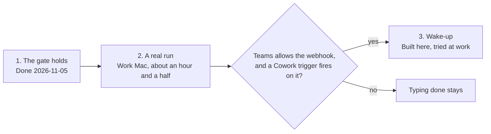

# Proposed roadmap

**Status: phase 1 is done, merged on 2026-11-05 as [pull request 1](https://github.com/broxgit/llm-relay/pull/1). Phases 2 and 3 are proposed.** The repository's [ROADMAP.md](../ROADMAP.md) stays the record of what's done and untested. [leverage.md](leverage.md) has what comes after these three.

Three phases in this order, with one condition: the wake-up is built only if the work-Mac session shows Teams and Cowork allow it. No dates, because the pace is about 10 hours a week and two phases wait on time at the work Mac. [design.md](design.md) has the designs behind phases 1 and 3.

| Phase | Where it happens | Needs from Brock | Done when |
|---|---|---|---|
| 1. The gate holds (done) | The personal Mac, no Cowork | A yes to Design 1, and a call on `--checks`. Both given | No pipe or variable answers the prompt. Tests answer through a pseudo-terminal. CI is green on Linux and macOS. `AGENTS.md`, `README.md` and `docs/using.md` say what the gate does and doesn't stop |
| 2. A real run | Work Mac, about an hour and a half | [The session](work-mac-session.md), and what it asks to bring back | Every item on `ROADMAP.md`'s Untested list is crossed off or has a recorded failure. The wake-up questions have answers |
| 3. Wake-up | Built on the personal Mac, then about 30 minutes on the work Mac | The answers from phase 2, then one more short session | A round finishes on the work Mac without typing "done", and a failed post falls back to today's message |

Phase 1 goes first so the real run exercises the final prompt. If phase 2 turns up a failure in something already built, fixing it comes before phase 3.

Parked, with no phase yet:

- Comparing a Cowork review with a Claude review of the same merge request.
- Sending the Go toolchain with a scan.
- Letting Cowork leave notes for the wiki through `wiki capture`.

## Decisions needed

The first two are answered, and phase 1 was built on them. The rest can wait until phase 2 is back. When one is made, write the answer and its date under it.

- [x] **Design 1 as written:** the prompt reads `/dev/tty`, `RELAY_TEST_TTY` goes, and the tests use a pseudo-terminal. Brock said to get started on 2026-11-05.
- [x] **`relay mr --checks`:** keep it as the one named exception to the keypress rule. Brock decided on 2026-11-05. Phase 1 was built that way, with the skill told never to hand the flag over.
- [ ] **The webhook address:** whether an address for a Teams chat, kept in a settings file on the work Mac, is acceptable under the company's rules. Phase 3 depends on it.
- [ ] **The MCP bridge:** drop it from `ROADMAP.md`, where it stands as the step after the wake-up.
- [ ] **The Go binary test:** drop the test of a Go binary in the skill folder.

## Decided

- 2026-11-05: these proposals live in this folder.
- 2026-11-05: start phase 1. It merged the same day, as [pull request 1](https://github.com/broxgit/llm-relay/pull/1).
- 2026-11-05: lean on Cowork far more at work, in the order in [leverage.md](leverage.md).
- 2026-11-05: `relay mr --checks` stays, as the one exception to the keypress rule.
