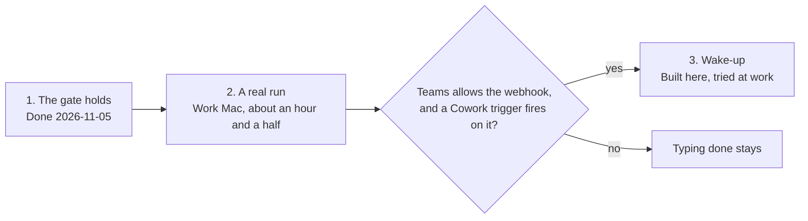

# Proposed roadmap

**Status: phase 1 is done, merged on 2026-11-05 as [pull request 1](https://github.com/broxgit/llm-relay/pull/1). Phase 2 ran on 2026-11-06, as the guided field test, and its fixes are release 0.2.2. Phase 3 can't be built as designed: the user's Teams had no Workflows app, so there is no webhook. [Team use](#team-use) was added on 2026-11-06, and nothing in it is built.** The repository's [ROADMAP.md](../ROADMAP.md) stays the record of what's done and untested. [leverage.md](leverage.md) has what comes after these three.

Three phases in this order, with one condition: the wake-up is built only if the work-Mac session shows Teams and Cowork allow it. No dates, because the pace is about 10 hours a week and two phases wait on time at the work Mac. [design.md](design.md) has the designs behind phases 1 and 3.

| Phase | Where it happens | Needs from Brock | Done when |
|---|---|---|---|
| 1. The gate holds (done) | The personal Mac, no Cowork | A yes to Design 1, and a call on `--checks`. Both given | No pipe or variable answers the prompt. Tests answer through a pseudo-terminal. CI is green on Linux and macOS. `AGENTS.md`, `README.md` and `docs/using.md` say what the gate does and doesn't stop |
| 2. A real run | Work Mac, about an hour and a half | [The session](work-mac-session.md), and what it asks to bring back | Every item on `ROADMAP.md`'s Untested list is crossed off or has a recorded failure. The wake-up questions have answers |
| 3. Wake-up | Built on the personal Mac, then about 30 minutes on the work Mac | The answers from phase 2, then one more short session | A round finishes on the work Mac without typing "done", and a failed post falls back to today's message |

Phase 1 goes first so the real run exercises the final prompt. If phase 2 turns up a failure in something already built, fixing it comes before phase 3.

## Team use

Added on 2026-11-06. The relay was built for one person who knows it well. It is now meant for the developers on Brock's team too, of varying skill levels, and they shouldn't need to know its commands or its unwritten rules.

Three pieces, in this order. They come after phase 2's report is read and its failures are fixed, and before phase 3 and the steps of [leverage.md](leverage.md) that aren't built. [guided.md](guided.md) has the design. A and B are built, as 0.2.5. Of C, the starting question and the short block are built, and the practice round is not. It ran with real Cowork once, on 2026-11-06, and the repository's [ROADMAP.md](../ROADMAP.md) has what that showed.

| # | Piece | What it does | Waits on |
|---|---|---|---|
| A | Say which tools a feature needs | `relay setup` lists each feature's tools and whether this Mac has them. A missing tool's error gives the install line and the sign-in step. One list in the code feeds every message, so a new dependency is one line | Nothing from Cowork. It can be built and tested on the personal Mac |
| B | The guided way in, in the terminal | `relay start` is the one command to learn. It checks the install, catches a stale skill after an upgrade, and puts a prompt for Cowork on the clipboard. Every command ends with a line saying what to do next, and `relay scan` gets a clipboard prompt as `relay mr` has | Nothing from Cowork, as for A |
| C | The guided way in, in Cowork | The everyday skill hands over each command in a short YOUR TURN block. Cowork asks what the user is working on and picks the first command. A practice round runs on the field test's throwaway repository | Phase 2's report, which says whether Cowork keeps to the block format |

What holds across all three:

- **Guidance goes in the terminal where it can.** The relay prints the same thing every time and can be tested without Cowork. Cowork has needed a second ask for steps it was told to give.
- **Tools stay optional.** Someone who never reviews a merge request isn't made to install `glab`. `relay setup` reports and doesn't refuse.
- **The keypress rule doesn't change.** The guide says which key and why. It never presses it.
- **The commands stay.** `relay scan` and `relay mr` work as they do now for anyone who knows them.

Today a user learns that `relay mr` needs `glab` when a review fails with `relay mr needs glab`, and the YOUR TURN block is only in the field-test skill.

## Parked

With no phase yet:

- Comparing a Cowork review with a Claude review of the same merge request.
- Sending the Go toolchain with a scan.
- Letting Cowork leave notes for the wiki through `wiki capture`.
- `relay survey`, proposed on 2026-11-06 and not to be built now. It would count a user's repositories and tools, such as languages, how tests are started and which hooks are installed, and print a report that is safe to share, so the relay can be fitted to a team's stack and not to one person's. A script that does this exists outside the repository. One thing has to be solved before it could ship: the part that lists names it finds in several repositories can print a name that belongs to the user's company.

## If Copilot went away

Added on 2026-11-08. Nobody expects it to. The question was how much of the relay would be wasted if it did, and the answer is less than it looks: the keypress before anything runs or lands, the packs made from a ticket, a branch, a merge request or a repository, the run harness, the secrets check and the flow don't depend on Copilot. They depend on OneDrive, and on a skills folder Cowork happens to read. What would be lost is Cowork's reach into Teams and email, and its tokens.

Two changes would turn that dependency into a setting. Neither is urgent, and neither is built.

- **Name the sync folder and the skills folder as settings,** with OneDrive and Cowork's folder as the defaults. Another agent that reads a synced folder could then take Cowork's part, with `relay setup` and no fork. Git could be a transport too: a deliverable pushed to a branch, and `relay run` fetching it, with no synced folder at all.
- **Let the packers write to a local folder,** with something like `--to DIR` on `relay ticket`, `scan`, `mr` and `branch`. The packs would then feed an assistant that runs on the Mac, a colleague, or a different agent in the cloud. `relay ticket` this way gives a local assistant a Jira ticket and its pages, which it can't reach either.

Smaller, from the same question: the secrets check as a command of its own, for anything about to leave the Mac.

## Slack

Proposed on 2026-11-08, and not built. Cowork reads Teams and email, and not Slack. Slack's own assistant, Slackbot, has no documented way to be asked a question from outside Slack. What Slack does offer is search: its MCP server at `mcp.slack.com` and its Real-time Search API, generally available since February 2026, which search messages, files and channels and read threads as the signed-in user.

- **The catch is who may connect.** Only an app published in Slack's directory, or an internal app the workspace's admins approve, may use either. So this starts with the company's Slack admins, not with code.
- **What the relay would do,** if an approved app existed: a pack like `relay ticket`'s, with the threads that mention a ticket's key or a merge request's address, run past the secrets check and sent to Cowork. It would keep the relay's rule on tokens: sign-in through the browser, by a tool that keeps the token to itself.
- **A route with no code:** a Microsoft 365 admin can add an MCP server as a connector for Copilot. If Slack's were added, Cowork could search Slack itself and the relay would have nothing to do.
- **Not known:** whether the company's Slack plan includes these, whether its admins would approve an app, and whether a command-line tool exists that signs in for a user the way `acli` does.

## Decisions needed

The first two are answered, and phase 1 was built on them. The rest can wait until phase 2 is back. When one is made, write the answer and its date under it.

- [x] **Design 1 as written:** the prompt reads `/dev/tty`, `RELAY_TEST_TTY` goes, and the tests use a pseudo-terminal. Brock said to get started on 2026-11-05.
- [x] **`relay mr --checks`:** keep it as the one named exception to the keypress rule. Brock decided on 2026-11-05. Phase 1 was built that way, with the skill told never to hand the flag over.
- [ ] **The webhook address:** whether an address for a Teams chat, kept in a settings file on the work Mac, is acceptable under the company's rules. Phase 3 depends on it.
- [ ] **The MCP bridge:** drop it from `ROADMAP.md`, where it stands as the step after the wake-up.
- [ ] **The Go binary test:** drop the test of a Go binary in the skill folder.
- [x] **The Jira tool:** `acli`, decided by what the two did on the work Mac on 2026-11-06. It covers Jira and Confluence and signs in through the browser. `jira` wanted an API token kept in the shell, and has no Confluence.

## Decided

- 2026-11-05: these proposals live in this folder.
- 2026-11-05: start phase 1. It merged the same day, as [pull request 1](https://github.com/broxgit/llm-relay/pull/1).
- 2026-11-05: lean on Cowork far more at work, in the order in [leverage.md](leverage.md).
- 2026-11-05: `relay mr --checks` stays, as the one exception to the keypress rule.
- 2026-11-06: the relay is for Brock's team too, so each feature gets guided. The team-use pieces wait for phase 2's report.
- 2026-11-06: a feature that depends on a tool tells the user so. Depending on a Jira command-line tool is fine.
- 2026-11-06: the order a piece of work goes in is [flow.md](flow.md). Brock adopted it, with his own addition that dependencies are read in both directions.
- 2026-11-06: design and build the guided way in. [guided.md](guided.md) has what was built and why.
- 2026-11-06: phase 2's report came back. The repository's [ROADMAP.md](../ROADMAP.md) has what passed, what 0.2.2 fixed, and what is still open. Three of its answers bear on what comes next: Cowork can't read Jira or Confluence and the Mac has `jira` and `acli`, a Go module with vendored dependencies builds in Cowork's sandbox, and Teams offered no way to make a webhook.
- 2026-11-09: OneDrive event triggers can't be relied on to wake Cowork, and a webhook trigger can. The relay may read that webhook's secret from the macOS Keychain, and only from there, as the one exception to its rule on secrets. [ask.md](ask.md) has both.
